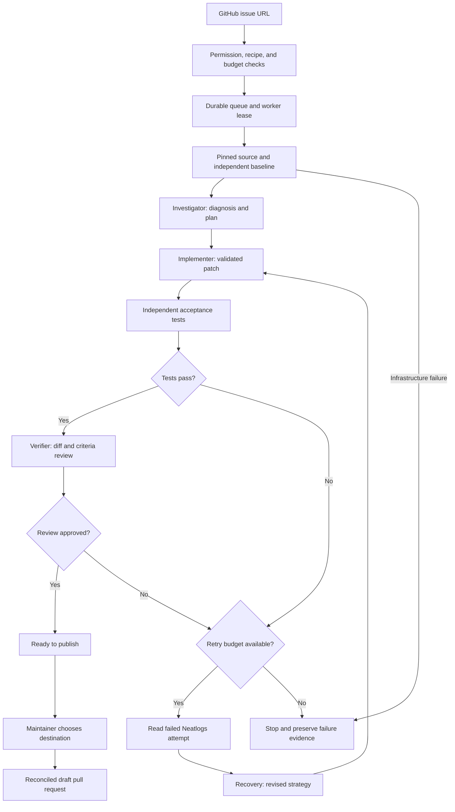
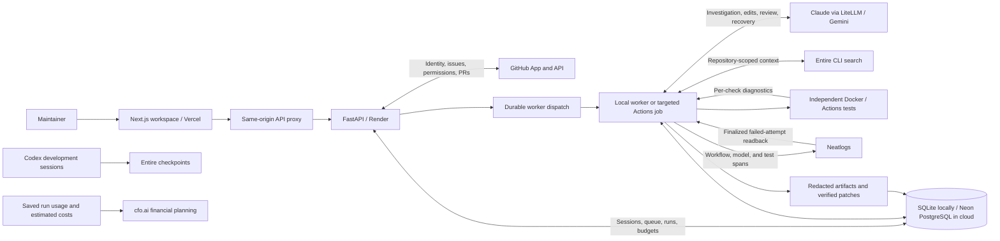

# Torque

**Turn a GitHub issue into a tested, reviewed pull request—with trace-informed recovery when an attempt fails.**

Torque is a multi-agent development assistant built for neatHack. It combines a GitHub-connected workspace, independent acceptance tests, bounded agent execution, and inspectable evidence. Maintainers choose when to publish a verified patch as a draft PR.

[Open Torque](https://torque-pied.vercel.app) · [Verification evidence](evidence/README.md) · [Deployment status](deployment.md) · [Financial plan](cfo.ai/README.md)

> Working prototype with verified controlled-repository results. The frontend and API are deployed; complete production worker and browser acceptance remains pending. Status below reflects saved evidence through October 13, 2026.

## The problem

Software teams and open-source maintainers spend substantial time turning an issue into a safe change: reproduce the bug, find the relevant code, implement a patch, test it, and explain it to a reviewer. Coding agents can help, but a plausible patch is not proof that the issue is fixed.

When an agent fails, a generic error or another blind retry leaves maintainers with the same debugging work. Unbounded retries consume money, while interrupted jobs and duplicate publication make automation harder to trust.

## Our solution

Torque makes the issue-to-PR process explicit and verifiable. Four agent roles investigate, implement, review, and recover, while deterministic controls enforce test and publication gates.

- **Reproduce before repairing:** run an independent baseline against the reviewed source revision.
- **Test the proposed behavior:** acceptance suites run separately from the credential-bearing agent. Model approval cannot override failed tests.
- **Recover using evidence:** inspect the exact failed attempt through Neatlogs when available, or clearly label a fallback to local artifacts.
- **Bound the work:** restrict editable files, preserve immutable tests, and cap retries, calls, tokens, spending, and execution time.
- **Keep maintainers in control:** preserve progress and evidence, then require explicit publication to an authorized repository or fork.

## How Torque works

1. **Connect GitHub and submit an issue.** Check repository permissions and whether a supported test recipe exists.
2. **Admit and queue the run.** Persist ownership, budget reservations, progress, and the worker lease.
3. **Reproduce the issue.** Download pinned source and run the independent acceptance baseline. Infrastructure failures cannot count as bug reproduction.
4. **Investigate.** Read the issue and reviewed context, optionally enriched by repository-scoped Entire search.
5. **Implement.** Propose validated edits within approved paths. Each attempt starts from the pinned originals.
6. **Test and review.** Independent tests check the patch; the verifier assesses the diff against the issue criteria.
7. **Recover or stop.** Failed attempts can trigger bounded trace-informed recovery. Exhausted budgets or retries stop the run without publishing.
8. **Publish explicitly.** A verified run reaches `ready_to_publish`. The maintainer chooses an authorized destination, and Torque creates a draft PR with reconciliation against duplicate side effects.



Hosted readback can be unavailable. Recovery then uses saved local diagnostics and records the evidence source; Torque does not claim hosted trace recovery occurred.

## Architecture and integrations

The Next.js workspace talks to FastAPI through a same-origin proxy. The API manages authentication, admission, history, cancellation, and publication. A separate worker executes agents; independent test jobs run the reviewed acceptance suites.



The diagram shows implemented integration paths. Targeted cloud worker dispatch is prepared, but complete hosted agent execution remains a deployment acceptance gate. cfo.ai supports business planning; it is not in the runtime loop.

| Component | Responsibility |
| --- | --- |
| Next.js, React, Tailwind | Landing page, GitHub connection, submission, progress, history, cancellation, publication |
| FastAPI | Authentication, ownership, repository eligibility, admission, run APIs, publication |
| Durable store | Local SQLite; optional PostgreSQL migrations, leases, events, budgets, private artifacts |
| Investigator | Diagnose the issue and plan from reviewed context |
| Implementer | Produce constrained, validated source edits |
| Verifier | Review the tested diff against acceptance criteria |
| Recovery | Use failed-attempt evidence to revise implementation strategy |
| Independent runner | Execute frozen suites in isolated Docker or GitHub Actions jobs |

## What we built and verified

| Area | Completed work | Evidence and scope |
| --- | --- | --- |
| Issue-to-PR execution | Real provider calls, baseline reproduction, independent browser tests, model review, controlled-fork publication | [Operator demo](evidence/runs/6634790aa28943629348e02914d9b56c/README.md); [PR #1](https://github.com/davre001/kokon/pull/1) |
| Connected-user flow | GitHub App login, encrypted credentials, authorization, browser submission, verified patch, explicit publication | [User-run evidence](evidence/github-app/README.md); [merged reduced-motion PR #3](https://github.com/davre001/kokon/pull/3) |
| Gallery accessibility | Independent keyboard/mouse calibration, hosted baseline, completed normal agent-run publication | [Gallery verification](backend/GALLERY_VERIFICATION.md); [publication readback](evidence/gallery/completed-publication.json); [merged PR #5](https://github.com/davre001/kokon/pull/5) |
| Trace-informed recovery | Deliberately incorrect fixture patch failed; finalized trace informed live recovery; unchanged assertion passed | [Controlled recovery drill](evidence/recovery/ce1d5d570a144e608d98d49031579dd2/README.md), separate from the GitHub PR demos |
| Acceptance diagnostics | Per-check child spans, bounded stdout/stderr, assertion stacks, redaction, hosted diagnostic payloads | [Hosted probe](evidence/acceptance-telemetry/c654b3eda3644bcf934215a577de51eb/README.md); [remote browser verification](evidence/remote-acceptance-instrumentation/bb8ee37b8d644425b7e1edc9ff7691d2/README.md) |
| Worker lifecycle | Durable history, leases, cancellation, restart fencing, interruption handling, Windows/Linux signal checks | [Lifecycle verification](backend/LIFECYCLE_VERIFICATION.md). Blocked-provider graceful shutdown used a localhost fixture |
| Publication resilience | Destination authorization, verified commit checks, controlled crash/reconciliation checks | [Publication design](backend/PUBLICATION.md); [lifecycle evidence](backend/LIFECYCLE_VERIFICATION.md). Crash-fixture PRs are separate from product fixes |
| Cloud storage and dispatch | Optional PostgreSQL, transactional admission/claims, private artifacts, targeted workers, bounded manual reconciliation | [Deployment checklist](deployment.md). Isolated Neon checks passed; full hosted execution remains pending |
| Frontend/API deployment | Vercel frontend, Render API health, signed-out proxy/session and OAuth entry boundaries | [Deployment status](deployment.md); [Torque frontend](https://torque-pied.vercel.app) |
| Cost controls and planning | Per-run/daily budgets, usage estimates, cfo.ai pricing and cash-flow model | [Financial plan](cfo.ai/README.md); [measured samples](cfo.ai/measured-run-costs.json) |

The saved deployment checklist reports **192 Python tests passed, five skipped**, plus TypeScript checks, proxy contracts, a production Next.js build, and Edge workspace fixture checks. These are recorded results, not a claim that every production path passed. See [test guidance](tests/README.md).

### Honest failure evidence

The current `davre001/kokon` remote recipe selects **slider-keyboard** for issue #7, replacing the completed gallery task. It admits reviewed revisions `218143b523252ee95c2368adc83fef95b324b156` and `513883a43ea33474431c933018b6267d08acb8f5`; the newer revision changes only a Gallery comment, leaving slider HTML/CSS unchanged. The October 13 Edge baseline passed **1/5** groups and reproduced four assertion failures. This is evidence of the outstanding bug, not a completed repair. See [current slider acceptance setup](tests/acceptance/slider/README.md).

The unseeded slider trial used real providers, Entire context, hosted tests, and failed-attempt readback, but exhausted three attempts with four of five test groups passing each time. **No PR was published.** Successful unseeded recovery remains unverified.

[Slider trial and diagnosis](evidence/slider/2aa4615e4cbf48deadd99a009b8da11b/README.md)

## How we used the hackathon tools

### Neatlogs: observability that informs recovery

Neatlogs captures workflow/attempt spans, model calls, test outcomes, and recovery evidence. Torque reads the exact finalized failed attempt when hosted readback is available. We also fixed an observability gap by exporting individual failed-check names, streams, and stack traces in canonical hosted tool output.

- [Controlled failed attempt](https://app.neatlogs.com/traces/e6417b8ff867e18db4fe1093548c91c2) and [passing recovery attempt](https://app.neatlogs.com/traces/ff5d1966ea773563a23d1743ec4b3851)
- [Successful connected-user workflow](https://app.neatlogs.com/traces/228da4f22bcbe4aeabf7bc797c9d89d1): saved finalized readback reports 12 spans and four model calls
- [Named assertion probe](https://app.neatlogs.com/traces/3d1061326c1185af4bec2113b7ebe57d) and [passing probe](https://app.neatlogs.com/traces/b08c025e327bcaf698b4b1348e57a2e8)
- [Recovery integration documentation](backend/NEATLOGS_RECOVERY.md)

### Entire: checkpoints and runtime context

Entire captures Codex-assisted development checkpoints and links agent work to commits. Our opt-in CLI search integration is scoped to the target repository; its code-search fallback checks paths and matching lines against reviewed source before supplying context to the investigator.

- [Captured checkpoint](https://entire.io/gh/davre001/Torque/commit/c081469dacf1dfa4ac8e291f19a3a4142244f94b): `01M4K5QBAVZ507XR140XFW7586`
- [Saved Gallery code-search result](evidence/entire-runtime/target-context.json), with a verified source-line match
- [Open-source CLI integration](backend/integrations/entire.py)

Checkpoint and CLI search usage are evidenced here. A separate Entire Graph risk-analysis workflow or changes to Entire itself are not claimed.

### cfo.ai: planning around operating costs

We used cfo.ai to model Maintainer, Starter, and Team subscriptions, inference/sandbox costs, recovery retries, success-rate sensitivity, revenue scenarios, and funding gaps. Real-run usage samples provide an initial comparison with forecast assumptions, including failed-run costs.

- [Financial plan and assumptions](cfo.ai/README.md)
- [Original workbook export](cfo.ai/torque-financial-plan.xlsx)
- [Dashboard screenshots](cfo.ai/screenshots/)
- [Measured run-cost samples](cfo.ai/measured-run-costs.json)

Forecasts are planning assumptions. Run costs are estimates from configured rates and provider-reported usage, not reconciled invoices or representative production averages.

## Safety and execution boundaries

- Encrypted server-side GitHub credentials and owner-scoped runs/artifacts.
- Expiring sessions, exact-origin checks, CSRF protection, and a same-origin frontend proxy.
- Reviewed recipes pin source revisions, editable paths, and independent criteria. App installation alone does not make a repository runnable.
- Docker tests exclude application credentials and restrict network, filesystem, resources, and output.
- Budget admission, bounded retries, and leases constrain execution and fence stale workers.
- Artifact redaction and telemetry masking exclude configured credentials from diagnostic exports.
- Publication requires passing verification and destination authorization, with interrupted-side-effect reconciliation.

[Audit and deployment gates](backend/DEPLOYMENT_READINESS.md) · [GitHub App setup](backend/GITHUB_APP.md) · [Publication controls](backend/PUBLICATION.md)

## Run locally

### Prerequisites

Python 3.11+, Git, and Node.js compatible with the frontend; configured model/GitHub/Neatlogs access; a reviewed recipe and prepared Docker or Actions runner. Entire CLI/login is needed when enabling runtime Entire context.

```powershell
git clone https://github.com/davre001/Torque.git
cd Torque
python -m venv .venv
.\.venv\Scripts\python.exe -m pip install -r requirements-dev.txt
npm.cmd --prefix frontend/ui ci
```

Use [.env.example](.env.example) as the configuration reference. Create `.env` only if one does not already exist; keep credentials private and never commit them. [requirements.lock.txt](requirements.lock.txt) records the exact tested Python environment.

Follow [backend setup](backend/README.md), [GitHub App setup](backend/GITHUB_APP.md), and [remote runner setup](backend/REMOTE_RUNNER.md) for credentials, conservative cost rates, recipes, and runner preparation. Example recipes contain placeholders and require review.

Connected users can enable their public repositories in the workspace's
**Repository tests** panel. Choose a repository, select npm or pytest, provide
the test/configuration files and editable source files, then validate. A passing
hosted validation enables that repository for that user. Later source commits
use the frozen test revision rather than the demo's hard-coded source pins.
Current limits include explicit file scope, supported npm test commands and a
lockfile, or pytest without third-party project dependencies. Repository access
continues to show names and readiness without per-repository setup forms.

Run these commands in separate terminals:

```powershell
# API
.\.venv\Scripts\python.exe -m uvicorn backend.api:app --host 127.0.0.1 --port 8000
```

```powershell
# Agent worker
.\.venv\Scripts\python.exe -m backend worker
```

```powershell
# Next.js frontend
npm.cmd run dev
```

Open `http://localhost:3000`; API documentation is at `http://127.0.0.1:8000/docs`. Configure matching frontend/backend origins and proxy settings before GitHub login.

For operator CLI use:

```powershell
.\.venv\Scripts\python.exe -m backend preflight
.\.venv\Scripts\python.exe -m backend run https://github.com/OWNER/REPOSITORY/issues/NUMBER
.\.venv\Scripts\python.exe -m backend status RUN_ID
.\.venv\Scripts\python.exe -m backend publish RUN_ID
```

`run` enqueues work and requires a worker. The issue must match an enabled, reviewed recipe. `publish` is explicit and requires a verified run and authorized destination. Historic demo revisions may no longer match current repository branches after merged PRs.

### Verification commands

```powershell
.\.venv\Scripts\python.exe -m pytest -q
npm.cmd --prefix frontend/ui exec -- tsc --noEmit
npm.cmd run build
```

Independent browser suites are excluded from ordinary pytest collection. Follow their reviewed configuration under [tests/acceptance](tests/acceptance) and [test documentation](tests/README.md).

## Deployment and remaining work

The hosting layout uses Vercel for the frontend, Render for the API, optional Neon PostgreSQL for shared state/private artifacts, and Actions for targeted workers and independent acceptance jobs. SQLite remains the local default.

The frontend/API passed basic deployment checks. Isolated PostgreSQL concurrency, persistence, and restore checks are recorded. October 13 schema-2/runtime-grant confirmation is user-reported; a fresh schema-2 encrypted backup remains pending.

Before claiming full production readiness, complete:

- A hosted worker run from browser login through tests, artifact retrieval, and explicit publication.
- Production second-user isolation, cancellation/interruption, retention, restore, and rollback checks.
- Successful unseeded recovery and graceful shutdown during an actual paid-provider request.
- Production credential/log exclusion, host/proxy limits, quotas, and billing review.

[Deployment checklist](deployment.md) records verified scope and outstanding gates. Onboarding remains policy-controlled; arbitrary repositories and unreviewed test commands are not automatically supported.

## Project documentation

The implementation and operations documents were refreshed on October 13 against repository code through `b6bff47` and saved evidence. They distinguish implemented behavior, recorded verification, and pending production acceptance. Earlier design milestones are retained as labeled history where relevant.

| Document | What it covers |
| --- | --- |
| [Backend progress](backend.md) | API capabilities, completed agent runs, current task policy, and verification scope |
| [Backend runtime guide](backend/README.md) | Dependencies, configuration, API/worker commands, and runner setup |
| [Backend implementation](backend_implementation.md) | Source map, durable storage, agent gates, and publication boundaries |
| [Frontend implementation](implementation.md) | Real workspace/session flow, polling, repository readiness, proxy, and browser checks |
| [Integrations](integration.md) | GitHub, models, Neatlogs, Entire, Neon, hosting, Actions, and cfo.ai boundaries |
| [Background worker](background_worker.md) | Leases, cancellation, targeted jobs, dispatch reconciliation, artifacts, and lifecycle evidence |
| [Deployment](deployment.md) | Saved hosting checks, database evidence, provisioning procedure, backups, and remaining acceptance gates |
| [Development changes](changes.md) | Recent recipe review, README/checkpoint publication, frontend/backend milestones, and outstanding work |

The workspace currently shows repository readiness labels rather than onboarding forms. Backend schema-2 setup storage remains implemented. Documentation updates do not establish a new deployed revision or a successful hosted worker run.

## Repository map

```text
backend/              FastAPI, agents, durable store, workers, integrations, tools
frontend/ui/          Next.js landing page, workspace, API proxy
tests/                Backend contracts, lifecycle tests, independent acceptance
.github/workflows/    CI, remote acceptance, lifecycle, targeted worker/dispatch
evidence/             Sanitized runs, trace readbacks, results, verification
cfo.ai/               Financial model, workbook, screenshots, cost samples
demo/motion/          Demo motion, narration, rendering assets
render.yaml           Proposed configuration; actual state is in deployment.md
```

## License

[MIT](LICENSE).
