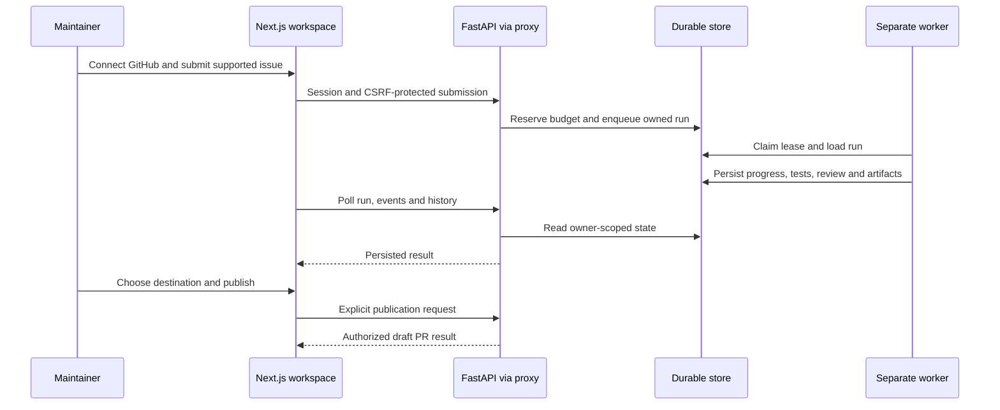

# Torque frontend implementation

Updated October 13, 2026 against the current source and saved verification. This replaces the earlier Suture/FastAPI-template proposal; the implemented product is Next.js plus the separate FastAPI API and durable worker.

## Pages and responsibilities

| Surface | Implemented behavior |
| --- | --- |
| `/` | Torque landing page, product explanation, GitHub login entry, and labeled illustrative preview |
| `/workspace` | Session-aware GitHub identity, repository readiness, issue submission, persisted progress/events and run history |
| Workspace result | Actual acceptance/review records, usage estimates, errors, cancellation and explicit draft-PR publication |
| Repository access | Installed repository list, access reconfirmation, automatic test detection and validation; manual setup when needed |
| Disconnect | Confirmed disconnect through the API, with session/authentication handling |
| `/api/` proxy | Server-side forwarding with cookie, redirect, origin and body boundaries; proxy credential stays server-side |

The workspace uses relative requests through `frontend/ui/lib/api.ts`. It polls persisted backend state rather than inventing timed agent progress. A fetch failure is a connectivity problem; it does not prove the worker failed. The decorative landing preview is separate from real workspace execution.

## Request and execution flow

The CLI and browser share the durable queue. Agent execution is not a FastAPI background task or a frontend animation. Successful runs stop at `ready_to_publish` until explicit publication.

## Current task policy

`davre001/kokon` now selects the reviewed slider recipe at revisions `218143b523252ee95c2368adc83fef95b324b156` or `513883a43ea33474431c933018b6267d08acb8f5`. Gallery and reduced-motion PRs remain historical verified results. An installed repository is runnable only when its revision and acceptance recipe are supported; the workspace automatically detects supported tests and starts hosted validation, with manual setup available when detection or validation needs help.

## Verification and limits

- [x] TypeScript, proxy contracts and production frontend build passed in the saved October 12 verification.
- [x] Edge workspace fixtures cover session/CSRF, progress/recovery, acceptance results, history, explicit publication, disconnect and expired login.
- [x] Saved controlled connected-user execution published reduced-motion PR #3; user-confirmed history/disconnect/reconnection evidence exists.
- [x] Basic deployed signed-out proxy/session and OAuth-entry checks are saved.
- [ ] Complete production browser login, second-user isolation, hosted worker execution and publication as one flow.
- [ ] Verify disconnect while publication is genuinely in flight.

Fixture API interception does not establish live production authentication or agent execution. No frontend code, landing assets or credentials were changed by this documentation update.

## Commands and references

Run `npm.cmd run dev` from the repository root. The API runs as `python -m uvicorn backend.api:app`; a separate local worker is required unless cloud dispatch is provisioned. See [backend runtime](backend/README.md) for complete setup.

[Product overview](README.md) ? [Backend implementation](backend_implementation.md) ? [Deployment](deployment.md) ? [Workspace test contracts](tests/README.md) ? [Connected-user evidence](evidence/github-app/README.md)
